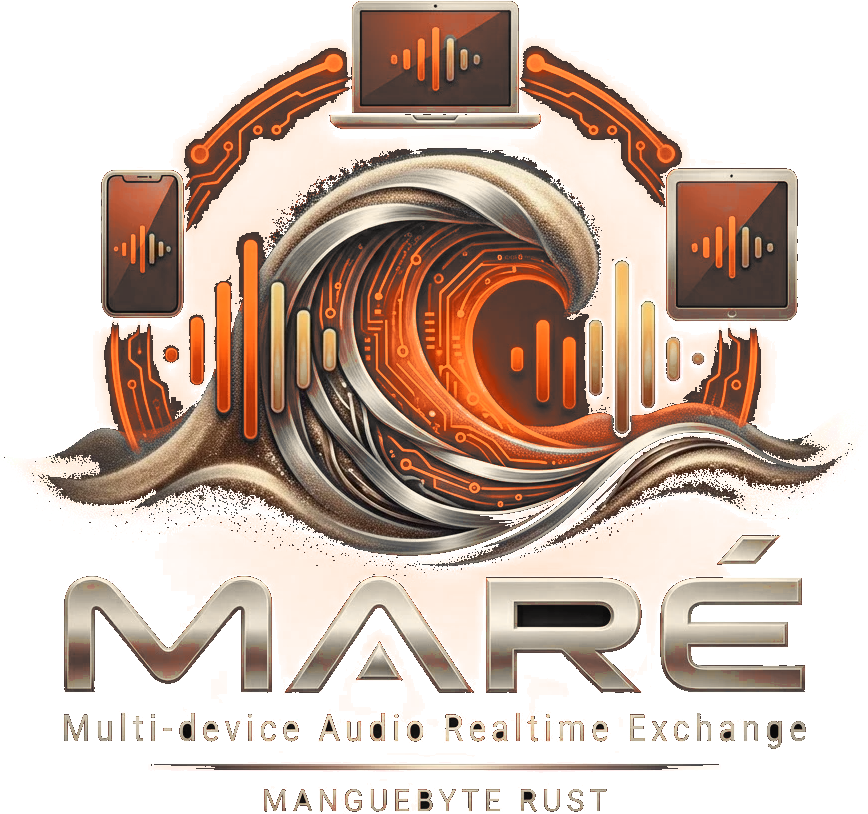

<p align="center">
  
</p>

# MARÉ

**Multi-device Audio Realtime Exchange**: an open protocol, and a hub that
implements it, for moving audio and MIDI between applications and audio
devices with low latency.

*Maré* is Portuguese for the tide. The mangrove lives by it, filling and
emptying in cycles, as audio buffers do.

MARÉ keeps what makes low-latency audio fast (applications write straight
into the buffers the device plays, on the device's schedule) and adds what
ASIO never had (ASIO is a trademark of Steinberg Media Technologies GmbH;
see [Trademarks](#trademarks)):

- **many applications at once** on the same device, each with low latency;
- **many devices as one**, with their clocks' drift corrected;
- **hot-plug**: devices come and go while the session runs;
- **MIDI 2.0 on the same clock** as the audio, to the sample;
- **latency said exactly**, part by part, and measured;
- **open**: MIT or Apache-2.0, a C layout any language can implement.

It is part of the ecosystem of the
[Manguebyte Audio Framework](https://github.com/alessonqueirozdev-hub/manguebyte),
from Recife: every program built on Manguebyte will speak MARÉ.

> **Status: milestones 3, 4 and 6 under way.** The shared-memory layout,
> the client library (Rust, C and C++), the hub and its drift-corrected
> aggregate of several devices are built and tested on Windows, Linux and
> macOS (CI), against fake devices. A WASAPI device (output, and input
> beside it) has been tried by hand on one real device
> ([docs/HARDWARE.md](docs/HARDWARE.md)); the `mare` program runs a hub on
> one, and programs built on Manguebyte play through it. [docs/DESIGN.md](docs/DESIGN.md)
> is the specification, including what MARÉ is not (not a kernel driver, and
> not lower latency than the hardware allows);
> [docs/LAYOUT.md](docs/LAYOUT.md) is the shared memory byte by byte, and
> [docs/TECH_DEBT.md](docs/TECH_DEBT.md) what the code still owes.

## The pieces

| Crate | What it is |
|---|---|
| `mare-protocol` | The shared-memory layout: no dependencies, no standard library |
| `mare-sys` | Named shared memory, doorbells, process watches, per system |
| `mare-client` | Connect to a hub and run a cycle each period |
| `mare-hub` | The hub: the cycle engine, the housekeeper, an aggregate of several devices, a fake device |
| `include/mare.h` | The layout in C, checked against the Rust one |
| `include/mare_client.h`, `mare_client.hpp` | The client library's interface, for C and C++17 |
| `mare-drift` | Drift correction: an adaptive resampler, its controller, and a link between two clocks |
| `mare-capi` | The client library for C and C++: `mareclient.dll` / `libmareclient.so` / `libmareclient.dylib` |
| `mare-manguebyte` | MARÉ as an audio backend of the Manguebyte Audio Framework |
| `mare-wasapi` | A WASAPI device, output and duplex input, exclusive or shared (Windows) |
| `mare-cli` | The `mare` program: lists devices, runs a hub on one, shows running hubs |

```bash
cargo test --workspace
```

## Running a hub

```bash
cargo run --release -p mare-cli -- devices
cargo run --release -p mare-cli -- run --device Realtek
cargo run --release -p mare-cli -- run --device UMC404HD --exclusive --period 64
cargo run --release -p mare-cli -- run --null
```

`mare run` keeps a hub called `main` running until Ctrl+C; programs connect
to it by that name (`--name` gives another). `--input` opens a capture
device beside the output, and `--follow` joins further output devices, each
on its own clock, resampled to the first. `--null` runs a hub on no device,
on any system, for trying programs without a sound card. `mare help` lists
every option.

```bash
cargo run --release -p mare-client --example sine -- --hub main --level -30
```

plays a quiet sine through a running hub, to hear that it works.

## Trademarks

ASIO is a trademark and software of Steinberg Media Technologies GmbH. MARÉ
is not affiliated with, endorsed by or derived from Steinberg or ASIO: it
uses no part of the ASIO SDK, and its name and its parts' names do not
contain "ASIO". The protocol is named here only to compare it with MARÉ.

## Licence

Licensed under either of [Apache License, Version 2.0](LICENSE-APACHE) or
[MIT license](LICENSE-MIT) at your option.
